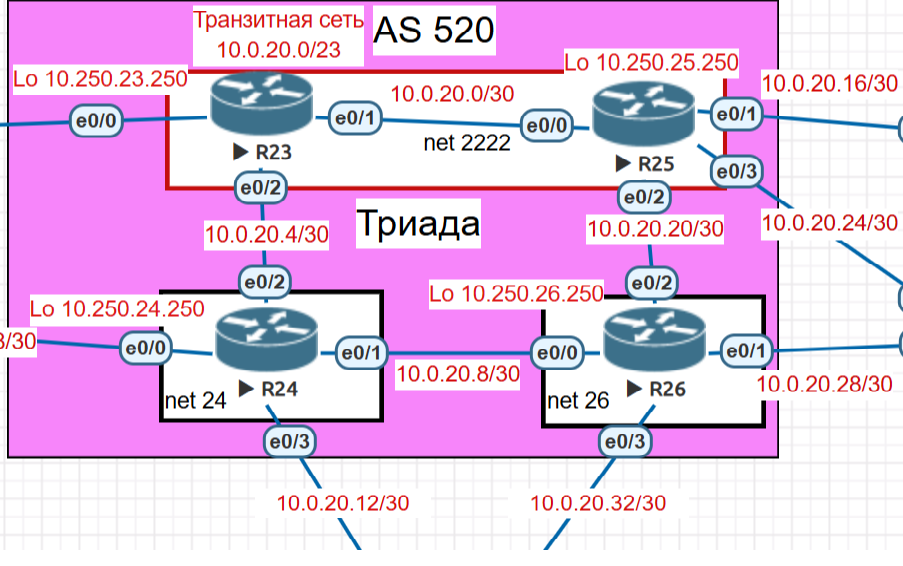

# Задание - настроить протокол IS-IS для IPv4 и IPv6 в ISP Триада.            

#### Настроите IS-IS в ISP Триада.
#### R23 и R25 находятся в зоне 2222.
#### R24 находится в зоне 24.
#### R26 находится в зоне 26.

### Схема сети Триада            

### Пояснения к схеме             
   Всего 4 маршрутизатора    
   R23 net 49.2222.0102.5002.3250.00          
   R24 net 49.0024.0102.5024.2500.00          
   R25 net 49.2222.0102.5002.5250.00            
   R26 net 49.0026.0102.5002.6250.00              
   Всего три зоны и 4 маршрутизатора                  
   Все 4 маршрутизатора настроим на Level-2 маршрутизацию.           
   is-type level-2-only            
   ! Включение режима Multi-Topology для раздельного расчета путей IPv4 и IPv6                
   address-family ipv6 unicast           
    multi-topology           
   exit-address-family            

### Настройки маршрутизатора R23

1. IPv4 уже настроен.
2. Ipv6            
   2.1 Включим Ipv6          
       ipv6 unicast-routing           
   2.2 Настройка интерфейсов           
      interface Ethernet0/0         
          ip address 10.0.16.6 255.255.255.252          
          ipv6 address FD00::2300:1/112            
      !         
      interface Ethernet0/1         
          ip address 10.0.20.1 255.255.255.252            
          ipv6 address FD00::2301:1/112           
      !                  
      interface Ethernet0/2           
          ip address 10.0.20.6 255.255.255.252             
          ipv6 address FD00::2302:1/112
3. Включим ISIS                      
      router isis 100               
      net 49.2222.0102.5002.3250.00               
      is-type level-2-only                     
      authentication mode md5           
      metric-style wide              
      log-adjacency-changes
      passive-interface default   /* по умолчанию все интерфейсы в режим passive                        
      no passive-interface Ethernet0/1                  
      no passive-interface Ethernet0/2                
      !             
      address-family ipv6          
      multi-topology           
      exit-address-family          
      !                    
                        
5. Настройка ISIS на интерфейсах                 
      !            
      interface Ethernet0/1                                  
      ip router isis 100      /* включить протокол маршрутизации на интерфейсе         
      ipv6 router isis 100   /* включить протокол маршрутизации на интерфейсе                                      
      !                  
      interface Ethernet0/2               
      ip router isis 100  /* включить протокол маршрутизации на интерфейсе                      
      ipv6 router isis 100 /* включить протокол маршрутизации на интерфейсе                                       
  
6. Диагностика.
   R23#show isis neighbors            

Tag 100:             
System Id      Type Interface   IP Address      State Holdtime Circuit Id        
R25            L2   Et0/1       10.0.20.2       UP    27       01         
R24            L2   Et0/2       10.0.20.5       UP    24       01           

R23#show isis database detail               
          
Tag 100:             
IS-IS Level-2 Link State Database:           
LSPID                 LSP Seq Num  LSP Checksum  LSP Holdtime      ATT/P/OL             
R23.00-00           * 0x0000001B   0xA62D        865               0/0/0           
  Area Address: 49.2222              
  Topology:     IPv4 (0x0)             
                IPv6 (0x2)             
  NLPID:        0xCC 0x8E          
  Hostname: R23              
  IP Address:   10.250.23.250          
  IPv6 Address: FD00::2302:1               
  Metric: 10         IS-Extended R25.00             
  Metric: 10         IS-Extended R24.00            
  Metric: 10         IS (MT-IPv6) R25.00            
  Metric: 10         IS (MT-IPv6) R24.00               
  Metric: 10         IP 10.0.16.4/30              
  Metric: 10         IP 10.0.20.0/30            
  Metric: 10         IP 10.0.20.4/30              
  Metric: 10         IP 10.250.23.250/32           
  Metric: 10         IPv6 (MT-IPv6) FD00::2300:0/112           
  Metric: 10         IPv6 (MT-IPv6) FD00::2301:0/112         
  Metric: 10         IPv6 (MT-IPv6) FD00::2302:0/112        
R24.00-00             0x0000001E   0xEAD1        989               0/0/0            
  Area Address: 49.0024              
  Topology:     IPv4 (0x0)              
                IPv6 (0x2)                
  NLPID:        0xCC 0x8E            
  Hostname: R24            
  IP Address:   10.250.24.250          
  IPv6 Address: FD00::2403:1          
  Metric: 10         IS-Extended R26.00                
  Metric: 10         IS-Extended R23.00             
  Metric: 10         IS (MT-IPv6) R26.00             
  Metric: 10         IS (MT-IPv6) R23.00             
  Metric: 10         IP 10.0.18.8/30              
  Metric: 10         IP 10.0.20.4/30              
  Metric: 10         IP 10.0.20.8/30             
  Metric: 10         IP 10.0.20.12/30               
  Metric: 10         IP 10.250.24.250/32               
  Metric: 10         IPv6 (MT-IPv6) FD00::2400:0/112            
  Metric: 10         IPv6 (MT-IPv6) FD00::2401:0/112            
  Metric: 10         IPv6 (MT-IPv6) FD00::2302:0/112             
  Metric: 10         IPv6 (MT-IPv6) FD00::2403:0/112           
R24.03-00             0x0000000A   0x56B1        0 (200)           0/0/0             
R25.00-00             0x0000001B   0xBDAC        989               0/0/0           
  Area Address: 49.2222           
  Topology:     IPv4 (0x0)            
                IPv6 (0x2)              
  NLPID:        0xCC 0x8E           
  Hostname: R25             
  IP Address:   10.250.25.250             
  IPv6 Address: FD00::2503:1             
  Metric: 10         IS-Extended R26.00           
  Metric: 10         IS-Extended R23.00             
  Metric: 10         IS (MT-IPv6) R26.00                
  Metric: 10         IS (MT-IPv6) R23.00             
  Metric: 10         IP 10.0.20.0/30          
  Metric: 10         IP 10.0.20.16/30          
  Metric: 10         IP 10.0.20.20/30          
  Metric: 10         IP 10.0.20.24/30           
  Metric: 10         IP 10.250.25.250/32            
  Metric: 10         IPv6 (MT-IPv6) FD00::2300:0/112              
  Metric: 10         IPv6 (MT-IPv6) FD00::2501:0/112           
  Metric: 10         IPv6 (MT-IPv6) FD00::2502:0/112          
  Metric: 10         IPv6 (MT-IPv6) FD00::2503:0/112          
R25.01-00             0x00000008   0xD724        0 (200)           0/0/0          
R26.00-00             0x0000001C   0x9A08        987               0/0/0           
  Area Address: 49.0026            
  Topology:     IPv4 (0x0)             
                IPv6 (0x2)            
  NLPID:        0xCC 0x8E            
  Hostname: R26              
  IP Address:   10.250.26.250                    
  Metric: 10         IS-Extended R25.00         
  Metric: 10         IS-Extended R24.00               
  Metric: 10         IS (MT-IPv6) R25.00          
  Metric: 10         IS (MT-IPv6) R24.00           
  Metric: 10         IP 10.0.20.8/30             
  Metric: 10         IP 10.0.20.20/30             
  Metric: 10         IP 10.0.20.28/30            
  Metric: 10         IP 10.0.20.32/30                
  Metric: 10         IP 10.250.26.250/32             
  Metric: 10         IPv6 (MT-IPv6) FD00::2400:0/112            
  Metric: 10         IPv6 (MT-IPv6) FD00::2401:0/112            
  Metric: 10         IPv6 (MT-IPv6) FD00::2601:0/112             
  Metric: 10         IPv6 (MT-IPv6) FD00::2502:0/112            
  Metric: 10         IPv6 (MT-IPv6) FD00::2603:0/112           
R26.01-00             0x0000000B   0x41A7        0 (728)           0/0/0               
R26.03-00             0x0000000C   0x31B4        0 (927)           0/0/0           

              
R23#show ip route isis           
                         
      10.0.0.0/8 is variably subnetted, 18 subnets, 2 masks            
i L2     10.0.18.8/30 [115/20] via 10.0.20.5, 00:19:24, Ethernet0/2           
i L2     10.0.20.8/30 [115/20] via 10.0.20.5, 00:19:24, Ethernet0/2          
i L2     10.0.20.12/30 [115/20] via 10.0.20.5, 00:19:24, Ethernet0/2          
i L2     10.0.20.16/30 [115/20] via 10.0.20.2, 00:10:36, Ethernet0/1           
i L2     10.0.20.20/30 [115/20] via 10.0.20.2, 00:10:36, Ethernet0/1            
i L2     10.0.20.24/30 [115/20] via 10.0.20.2, 00:10:36, Ethernet0/1           
i L2     10.0.20.28/30 [115/30] via 10.0.20.5, 00:07:04, Ethernet0/2            
                       [115/30] via 10.0.20.2, 00:07:04, Ethernet0/1            
i L2     10.0.20.32/30 [115/30] via 10.0.20.5, 00:07:04, Ethernet0/2            
                       [115/30] via 10.0.20.2, 00:07:04, Ethernet0/1           
i L2     10.250.24.250/32 [115/20] via 10.0.20.5, 00:19:24, Ethernet0/2            
i L2     10.250.25.250/32 [115/20] via 10.0.20.2, 00:10:36, Ethernet0/1                 
i L2     10.250.26.250/32 [115/30] via 10.0.20.5, 00:07:04, Ethernet0/2             
                          [115/30] via 10.0.20.2, 00:07:04, Ethernet0/1             
R23#show ipv6 route isis          
IPv6 Routing Table - default - 15 entries
Codes: C - Connected, L - Local, S - Static, U - Per-user Static route           
       B - BGP, HA - Home Agent, MR - Mobile Router, R - RIP           
       H - NHRP, I1 - ISIS L1, I2 - ISIS L2, IA - ISIS interarea        
       IS - ISIS summary, D - EIGRP, EX - EIGRP external, NM - NEMO         
       ND - ND Default, NDp - ND Prefix, DCE - Destination, NDr - Redirect            
       O - OSPF Intra, OI - OSPF Inter, OE1 - OSPF ext 1, OE2 - OSPF ext 2          
       ON1 - OSPF NSSA ext 1, ON2 - OSPF NSSA ext 2, la - LISP alt          
       lr - LISP site-registrations, ld - LISP dyn-eid, a - Application          
I2  FD00::2400:0/112 [115/20]              
     via FE80::A8BB:CCFF:FE01:8020, Ethernet0/2            
I2  FD00::2401:0/112 [115/20]            
     via FE80::A8BB:CCFF:FE01:8020, Ethernet0/2            
I2  FD00::2403:0/112 [115/20]             
     via FE80::A8BB:CCFF:FE01:8020, Ethernet0/2            
I2  FD00::2501:0/112 [115/20]            
     via FE80::A8BB:CCFF:FE01:9000, Ethernet0/1          
I2  FD00::2502:0/112 [115/20]            
     via FE80::A8BB:CCFF:FE01:9000, Ethernet0/1         
I2  FD00::2503:0/112 [115/20]            
     via FE80::A8BB:CCFF:FE01:9000, Ethernet0/1           
I2  FD00::2601:0/112 [115/30]              
     via FE80::A8BB:CCFF:FE01:8020, Ethernet0/2              
     via FE80::A8BB:CCFF:FE01:9000, Ethernet0/1               
I2  FD00::2603:0/112 [115/30]               
     via FE80::A8BB:CCFF:FE01:8020, Ethernet0/2           
     via FE80::A8BB:CCFF:FE01:9000, Ethernet0/1               
        

