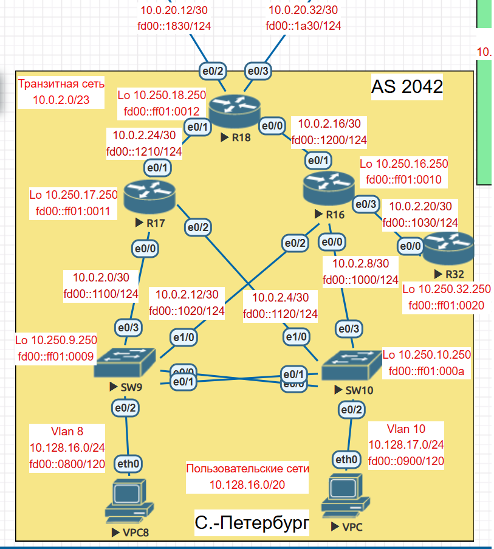

## Лабораторная работа №5
### Задание.
1. В офисе С.-Петербург настроить EIGRP.
2. R32 получает только маршрут по умолчанию.
3. R16-17 анонсируют только суммарные префиксы.
4. Использовать EIGRP named-mode для настройки сети.

               

1. Настраиваем отдельные экземпляры автономных систем:                   
   1.1. autonomous-system 100 для Ipv4.               
   1.2. autonomous-system 200 для Ipv6.
2. По умолчанию все интерфейсы в режим passive -  passive-interface. NO passive-interface включаем только на тех интерфейсах где есть соседи.
3. Командой network прописываем все сети которые хотим анонсировать.
4. Для того чтобы R32 получал только маршруты по умолчанию на интерфейсе e0/3 R16 прописываю команду summary-address.
5. R16-17 анонсируют только суммарные префиксы. Суммарные префиксы будем анонсировать в сторону R18.                           
   5.1 Суммаризация пользовательских сетей 10.128.16.0/ и 10.128.17.0/24 произведем на SW9 на интерфейсах Vlan101 и Vlan102, SW10 на интерфейсах Vlan 103, Vlan 104.                           
   5.2 Суммаризация транзитных сетей выполняется на R16 и R17 интерфейс e0/1, сети 10.0.2.0/30, 10.0.2.4/30, 10.0.2.8/30, 10.0.2.12/30. Команда  summary-address 10.0.2.0 255.255.255.248, summary-address 10.0.2.8 255.255.255.248.                            
6. IPv6 Пользовательские сети fd00::0800/120 и fd00::0900/120. Суммаризируем до fd00::0800/119                                   

/ ***************** Настройки роутера R16 ********************** /                     
router eigrp Piter            
 !
 address-family ipv4 unicast autonomous-system 100           
  !          
  af-interface default         
   passive-interface        
  exit-af-interface        
  !       
  af-interface Ethernet0/1           
   summary-address 10.0.2.0 255.255.255.248  / ******* суммаризация транзитных сетей IPv4 в сторону R18  ****** /        
   summary-address 10.0.2.8 255.255.255.248  / ******* суммаризация транзитных сетей IPv4 в сторону R18  ****** /          
   no passive-interface              
  exit-af-interface          
  !            
  af-interface Ethernet0/2                
   no passive-interface               
  exit-af-interface                
  !                
  af-interface Ethernet0/0               
   no passive-interface              
  exit-af-interface             
  !              
  af-interface Ethernet0/3              
   summary-address 0.0.0.0 0.0.0.0 / ********** маршрут по умолчанию в сторону R32 для IPv4 ************** /             
   no passive-interface             
  exit-af-interface            
  !              
  topology base            
  exit-af-topology             
  network 10.0.2.8 0.0.0.3           
  network 10.0.2.12 0.0.0.3           
  network 10.0.2.16 0.0.0.3         
  network 10.0.2.20 0.0.0.3            
  network 10.250.16.250 0.0.0.0            
  eigrp router-id 10.250.16.250            
 exit-address-family                
 !              
 address-family ipv6 unicast autonomous-system 200            
  !               
  af-interface default              
   passive-interface             
  exit-af-interface              
  !           
  af-interface Ethernet0/1             
   summary-address FD00::1000/119 / ******* суммаризация транзитных сетей IPv6 в сторону R18  ****** /            
   summary-address FD00::FF01:0/120   / ******* суммаризация lo IPv6 в сторону R18  ****** /        
   no passive-interface            
  exit-af-interface            
  !           
  af-interface Ethernet0/2            
   no passive-interface             
  exit-af-interface          
  !            
  af-interface Ethernet0/0               
   no passive-interface              
  exit-af-interface             
  !            
  af-interface Ethernet0/3             
   summary-address ::/0    / ********** маршрут по умолчанию в сторону R32 для IPv6 ************** /           
   no passive-interface              
  exit-af-interface              
  !             
  topology base             
  exit-af-topology                  
  eigrp router-id 10.250.16.250             
 exit-address-family          
!                     
/ ****************************** конец настройки R16 ***************************** /              
