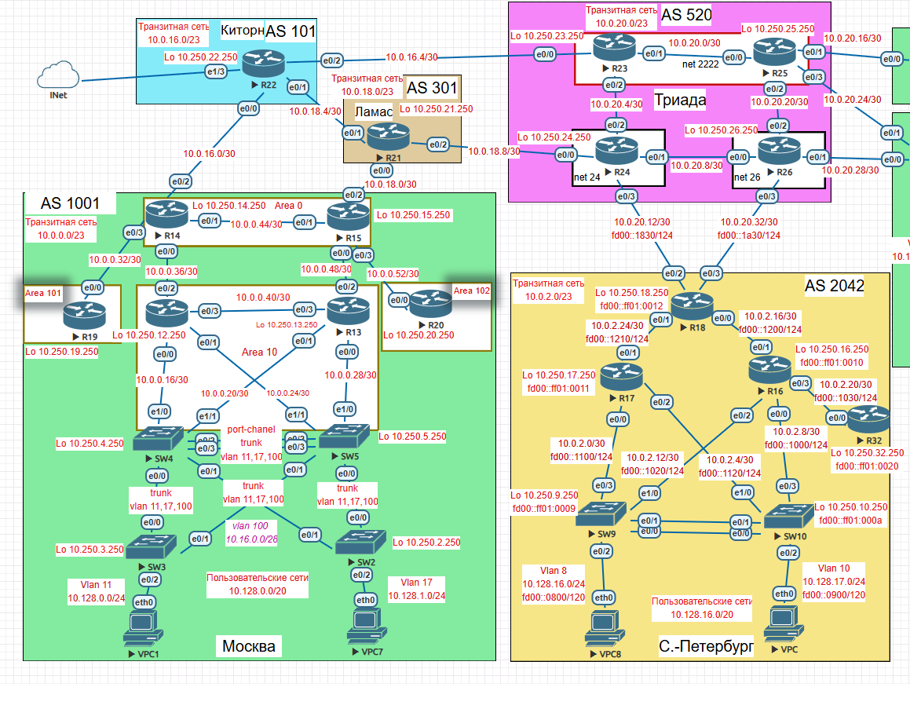

# Лабораторная работа №6
## Задание                

1. Настроите eBGP между офисом Москва и двумя провайдерами - Киторн и Ламас.               
2. Настроите eBGP между провайдерами Киторн и Ламас.              
3. Настроите eBGP между Ламас и Триада.               
4. Настроите eBGP между офисом С.-Петербург и провайдером Триада.              
5. Организуете IP доступность между пограничным роутерами офисами Москва и С.-Петербург.              
6. План работы и изменения зафиксированы в документации.             
                    
            

### Таблица автономных систем            

| Наименование офиса / провайдера | Номер AS | Пограничный роутер | Ip Loopback 0 |            
|--------------------|----------|--------------------|---------------|        
| Москва  | 1001 | R14 | 10.250.14.250 |      
| Москва  | 1001 | R15 | 10.250.15.250 |
| Киторн  | 101  | R22 | 10.250.22.250 |
| Ламас   | 301  | R21 | 10.250.21.250 |
| С.Петербург | 2042 | R18 | 10.250.18.250 |
| Триада  | 520  | R23 | 10.250.23.250 |
| Триада  | 520  | R24 | 10.250.24.250 |
| Триада  | 520  | R25 | 10.250.25.250 |
| Триада  | 520  | R26 | 10.250.26.250 |        

### 1. eBGP между офисом Москва и двумя провайдерами - Киторн и Ламас.          

R14       
 / *** конфигурация BGP                  
 router bgp 1001                   
 bgp router-id 10.250.14.250                 
 bgp log-neighbor-changes                  
 network 10.128.0.0 mask 255.255.240.0 /* анонсируем пользовательские сети */               
 network 10.250.14.250 mask 255.255.255.255  /* анонсируем lo 0 **********/               
 neighbor 10.0.0.46 remote-as 1001  /* сосед iBGP                
 neighbor 10.0.16.2 remote-as 101   /* сосед eBGP в сторону Киторн             

  / ************ end R14 *********** /                  
             
R15                 
  / *********** конфигурация BGP ************ /         
  router bgp 1001                 
  bgp router-id 10.250.15.250                    
  bgp log-neighbor-changes                     
  network 10.128.0.0 mask 255.255.240.0   / * анонсируем пользовательские сети * /                
  network 10.250.15.250 mask 255.255.255.255  /* анонсируем lo 0 **********/              
  neighbor 10.0.0.45 remote-as 1001     / * сосед iBGP               
  neighbor 10.0.18.2 remote-as 301    / * сосед eBGP в сторону Ламас                      
  / ************ end R15 *********** /                  

R22                   
  / *********** конфигурация BGP ************ /         
  router bgp 101          
  bgp router-id 10.250.22.250           
  bgp log-neighbor-changes            
  network 10.250.22.250 mask 255.255.255.255 / * анонсируем lo 0 ********** /  
  neighbor 10.0.16.1 remote-as 1001 / * сосед eBGP  в сторону Москва     
  neighbor 10.0.16.6 remote-as 520  / * сосед eBGP  в сторону Триада       
  neighbor 10.0.18.5 remote-as 301  / * сосед eBGP  в сторону Ламас         
  / ************ end R22 *********** /                  

R21            
  / *********** конфигурация BGP ************ /         
  router bgp 301           
  bgp router-id 10.250.21.250         
  bgp log-neighbor-changes           
  network 10.250.21.250 mask 255.255.255.255  / * анонсируем lo 0 ********** /         
  neighbor 10.0.18.1 remote-as 1001  / * сосед eBGP  в сторону Москва                  
  neighbor 10.0.18.6 remote-as 101   / * сосед eBGP  в сторону Киторн                   
  neighbor 10.0.18.10 remote-as 520  / * сосед eBGP  в сторону Триада          
  / ************ end R21 *********** /              

  ### Настройки AS Триада

  R23                   
    / *********** конфигурация BGP ************ /         
    router bgp 520           
    bgp router-id 10.250.23.250          
    bgp log-neighbor-changes          
    network 10.250.23.250 mask 255.255.255.255  / * анонсируем lo 0 ********** /         
    neighbor 10.0.16.5 remote-as 101  / * сосед eBGP  в сторону Киторн                         
    neighbor 10.250.24.250 remote-as 520   / * сосед iBGP                   
    neighbor 10.250.24.250 update-source Loopback0
    neighbor 10.250.25.250 remote-as 520   / * сосед iBGP               
    neighbor 10.250.25.250 update-source Loopback0
    neighbor 10.250.26.250 remote-as 520   / * сосед iBGP               
    neighbor 10.250.26.250 update-source Loopback0
    / ************ end R23 *********** /                 

  R24                 
    / *********** конфигурация BGP ************ /         
    router bgp 520          
    bgp router-id 10.250.24.250         
    bgp log-neighbor-changes          
    network 10.250.24.250 mask 255.255.255.255  / * анонсируем lo 0 **********/                          
    neighbor 10.0.18.9 remote-as 301 / * сосед eBGP  в сторону Ламас         
    neighbor 10.0.20.13 remote-as 2042  / * сосед eBGP  в сторону С.-Петербург       
    neighbor 10.250.23.250 remote-as 520 / * сосед iBGP        
    neighbor 10.250.23.250 update-source Loopback0         
    neighbor 10.250.25.250 remote-as 520 / * сосед iBGP       
    neighbor 10.250.25.250 update-source Loopback0                     
    neighbor 10.250.26.250 remote-as 520 / * сосед iBGP        
    neighbor 10.250.26.250 update-source Loopback0                   
    / ************ end R24 *********** /                 

  R25            
    / *********** конфигурация BGP ************ /               
    router bgp 520
    bgp router-id 10.250.25.250
    bgp log-neighbor-changes
    network 10.250.25.250 mask 255.255.255.255 / * анонсируем lo 0 **********/               
    neighbor 10.250.23.250 remote-as 520 / * сосед iBGP        
    neighbor 10.250.23.250 update-source Loopback0
    neighbor 10.250.24.250 remote-as 520 / * сосед iBGP        
    neighbor 10.250.24.250 update-source Loopback0
    neighbor 10.250.26.250 remote-as 520 / * сосед iBGP        
    neighbor 10.250.26.250 update-source Loopback0
    / ************ end R25 *********** /                 

  R26           
     / *********** конфигурация BGP ************ /                
     router bgp 520            
     bgp router-id 10.250.26.250             
     bgp log-neighbor-changes          
     network 10.250.26.250 mask 255.255.255.255  / * анонсируем lo 0 ********** /                           
     neighbor 10.0.20.33 remote-as 2042 / * сосед eBGP  в сторону С.-Петербург                 
     neighbor 10.250.23.250 remote-as 520 / * сосед iBGP                 
     neighbor 10.250.23.250 update-source Loopback0           
     neighbor 10.250.24.250 remote-as 520 / * сосед iBGP                   
     neighbor 10.250.24.250 update-source Loopback0            
     neighbor 10.250.25.250 remote-as 520 / * сосед iBGP                    
     neighbor 10.250.25.250 update-source Loopback0             
     / ************ end R26 *********** /                          

### 4. Настроите eBGP между офисом С.-Петербург и провайдером Триада.          

   R18
     / *********** конфигурация BGP ************ /                
     router bgp 2042
     bgp router-id 10.250.18.250
     bgp log-neighbor-changes
     network 10.128.16.0 mask 255.255.240.0 / * анонсируем пользовательские сети * /               
     network 10.250.18.250 mask 255.255.255.255 / * анонсируем lo 0 ********** /                           
     neighbor 10.0.20.14 remote-as 520 / * сосед eBGP  в сторону Триада                            
     neighbor 10.0.20.34 remote-as 520 / * сосед eBGP  в сторону Триада                            
     / ************ end R18 *********** /                          

### Организуете IP доступность между пограничным роутерами офисами Москва и С.-Петербург. 

#### Команды диагностики           
    R18#ping ip 10.250.14.250 source 10.250.18.250        
    Type escape sequence to abort.           
    Sending 5, 100-byte ICMP Echos to 10.250.14.250, timeout is 2 seconds:        
    Packet sent with a source address of 10.250.18.250        
    !!!!!         
    Success rate is 100 percent (5/5), round-trip min/avg/max = 1/1/1 ms         
    R18#ping ip 10.250.15.250 source 10.250.18.250            
    Type escape sequence to abort.        
    Sending 5, 100-byte ICMP Echos to 10.250.15.250, timeout is 2 seconds:          
    Packet sent with a source address of 10.250.18.250       
    !!!!!          
    Success rate is 100 percent (5/5), round-trip min/avg/max = 1/1/1 ms            
             
R18#show bgp ipv4 unicast             
BGP table version is 18, local router ID is 10.250.18.250               
Status codes: s suppressed, d damped, h history, * valid, > best, i - internal,          
              r RIB-failure, S Stale, m multipath, b backup-path, f RT-Filter,         
              x best-external, a additional-path, c RIB-compressed,          
Origin codes: i - IGP, e - EGP, ? - incomplete            
RPKI validation codes: V valid, I invalid, N Not found          
           
     Network          Next Hop            Metric LocPrf Weight Path           
 *   10.128.0.0/20    10.0.20.34                             0 520 301 1001 i   / *****  Пользовательская сеть Москва  ****** /           
 *>                   10.0.20.14                             0 520 301 1001 i            
 *>  10.128.16.0/20   0.0.0.0                  0         32768 i                / *****  Пользовательская сеть С.-Петербург  ****** / 
 *   10.250.14.250/32 10.0.20.34                             0 520 301 1001 i             
 *>                   10.0.20.14                             0 520 301 1001 i           
 *   10.250.15.250/32 10.0.20.34                             0 520 301 1001 i          
 *>                   10.0.20.14                             0 520 301 1001 i          
 *>  10.250.18.250/32 0.0.0.0                  0         32768 i           
 *   10.250.21.250/32 10.0.20.34                             0 520 301 i         
 *>                   10.0.20.14                             0 520 301 i           
 *   10.250.22.250/32 10.0.20.34                             0 520 101 i            
 *>                   10.0.20.14                             0 520 101 i           
 *   10.250.23.250/32 10.0.20.34                             0 520 i             
 *>                   10.0.20.14                             0 520 i               
 *   10.250.24.250/32 10.0.20.34                             0 520 i         
 *>                   10.0.20.14               0             0 520 i         
 *   10.250.25.250/32 10.0.20.14                             0 520 i          
 *>                   10.0.20.34                             0 520 i         
 *   10.250.26.250/32 10.0.20.14                             0 520 i          
 *>                   10.0.20.34               0             0 520 i                

Все пограничные роутеры доступны. Анонсируемые пользовательские сети доступны.            

